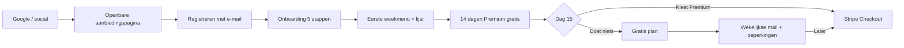
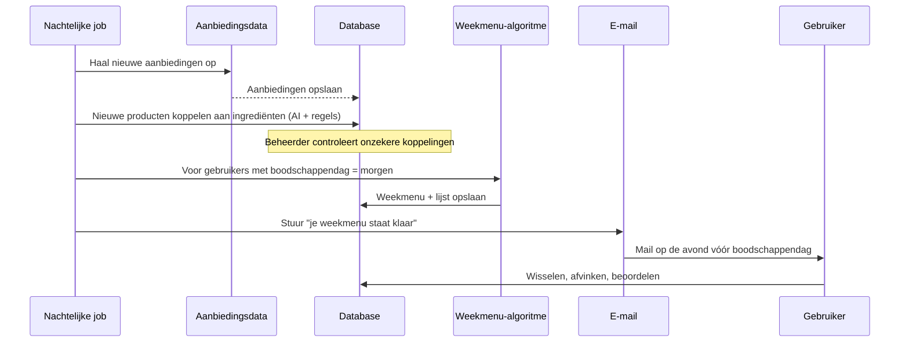

# 04 — Functionele specificatie

Dit document beschrijft **wat** het product doet: scope, pagina's, user stories met acceptatiecriteria en randgevallen. **Hoe** het gebouwd wordt, staat in [07 — Technische architectuur](07-technische-architectuur.md).

## 1. Scope van de eerste versie (MoSCoW)

### Must have (zonder dit geen lancering)
- Landingspagina met wachtlijst (fase 0)
- Wekelijkse aanbiedingen van **3 supermarkten: Albert Heijn, Jumbo, Lidl**
- Receptendatabase met **minimaal 150 recepten** (waarvan ≥ 40 vegetarisch)
- Openbare pagina's "Goedkoop koken met de aanbiedingen van deze week" per supermarkt
- Account aanmaken met e-mail (inloglink, geen wachtwoord)
- Onboarding: huishouden, supermarkt, boodschappendag, budget, dieet
- Automatisch weekmenu + boodschappenlijst (algoritme v1)
- Recept wisselen
- Boodschappenlijst afvinken, ook offline in de winkel
- Bespaarteller (deze week)
- Premium-abonnement via Stripe (maand en jaar) met 14 dagen gratis Premium bij aanmelden
- Online opzeggen en herroepen
- Wekelijkse e-mail "je weekmenu staat klaar"
- Beheeromgeving: aanbiedingen koppelen aan ingrediënten, recepten beheren
- Privacyverklaring, algemene voorwaarden, cookieverklaring

### Should have (in de eerste maanden na lancering)
- Goedkoopste-winkel-keuze over meerdere supermarkten
- Restjesslimme planning (overlap ingrediënten)
- Gedeelde lijst via een link
- Bespaarteller over maand, jaar en totaal
- Aldi en Plus toevoegen
- Favorieten en beoordelen ("lekker" / "niet meer")
- "Heb ik al in huis" (voorraad) voor basisproducten

### Could have (later)
- Lunch en ontbijt plannen
- Voedingswaarden per recept
- Kookmodus (scherm blijft aan, stap voor stap)
- Doorverwijsprogramma ("geef een maand cadeau")
- B2B-accounts voor budgetcoaches

### Won't have (bewust niet)
- Eigen mobiele app in de App Store / Play Store (we doen een installeerbare webapp)
- Bestellen of bezorgen
- Prijsvergelijking van het volledige assortiment
- Sociale functies (reacties, volgen)

## 2. Pagina's (sitemap)

```
Openbaar (geen login)
├── /                                   Landingspagina
├── /aanbiedingen                       Overzicht: recepten met de aanbiedingen van deze week
│   └── /aanbiedingen/[supermarkt]      Bijv. /aanbiedingen/lidl — wekelijks nieuw (SEO)
├── /recepten                           Receptenoverzicht met filters
│   └── /recepten/[slug]                Receptpagina (met "deze week in de aanbieding bij …")
├── /prijzen                            Gratis vs. Premium
├── /over                               Over Potje, onafhankelijkheid, bron van de data
├── /veelgestelde-vragen
├── /privacy  /voorwaarden  /cookies
├── /lijst/[deel-token]                 Gedeelde boodschappenlijst (alleen lezen + afvinken)
└── /inloggen

Ingelogd
├── /start                              Onboarding (eerste keer)
├── /week                               Weekmenu van deze week (hoofdscherm)
│   └── /week/[datum]                   Een eerder of volgend weekmenu
├── /lijst                              Boodschappenlijst van deze week
├── /besparing                          Bespaarteller
├── /favorieten
└── /account
    ├── /account/voorkeuren             Huishouden, budget, dieet, winkels, boodschappendag
    ├── /account/abonnement             Plan, upgraden, opzeggen, herroepen, facturen
    └── /account/privacy                Gegevens downloaden, account verwijderen

Beheer (alleen beheerder)
├── /beheer/aanbiedingen                Koppelingen aanbieding → ingrediënt controleren
├── /beheer/recepten                    Recepten toevoegen en bewerken
├── /beheer/ingredienten                Ingrediëntenlijst, referentieprijzen, pakgroottes
└── /beheer/statistieken                Kerncijfers
```

## 3. User stories en acceptatiecriteria

Notatie: **Als** [rol] **wil ik** [actie] **zodat** [doel]. Daaronder de acceptatiecriteria (AC).

### E1 — Landingspagina en wachtlijst (fase 0)

**US-1.1** Als bezoeker wil ik in 5 seconden begrijpen wat Potje doet, zodat ik weet of het iets voor mij is.
- AC1: Boven de vouw staan een kop, een subkop, één knop ("Zet me op de wachtlijst") en een voorbeeld van een weekmenu met totaalprijs en besparing.
- AC2: De pagina laadt op een middenklasse telefoon via 4G in minder dan 2 seconden (LCP < 2,5 s).

**US-1.2** Als bezoeker wil ik me met mijn e-mailadres aanmelden voor de wachtlijst, zodat ik bericht krijg bij de lancering.
- AC1: Alleen een e-mailadres is verplicht. Optioneel: supermarkt(en) en huishoudgrootte (voor onderzoek).
- AC2: Er wordt een bevestigingsmail gestuurd (double opt-in). Pas na de klik telt de aanmelding.
- AC3: Na aanmelding ziet de bezoeker zijn plek op de wachtlijst en een persoonlijke deellink ("schuif 10 plekken op per vriend").
- AC4: Hetzelfde e-mailadres twee keer aanmelden geeft geen fout, maar een vriendelijke melding.
- AC5: Er staat een duidelijke privacytekst bij het formulier (waarvoor, hoe lang, uitschrijven).

**US-1.3** Als maker wil ik meten hoeveel bezoekers zich aanmelden en via welke bron, zodat ik de vraag kan valideren.
- AC1: Bezoeken en aanmeldingen worden geteld zonder tracking-cookies (Plausible).
- AC2: UTM-bron wordt opgeslagen bij de aanmelding.

### E2 — Openbare aanbiedingspagina's

**US-2.1** Als bezoeker wil ik zien welke recepten ik deze week goedkoop kan maken bij mijn supermarkt, zodat ik zonder account inspiratie krijg.
- AC1: Per supermarkt staan de 10 recepten met de meeste besparing per portie, voor 4 personen.
- AC2: Per recept staat de geschatte prijs per portie en welke ingrediënten in de aanbieding zijn.
- AC3: De pagina wordt elke nacht automatisch bijgewerkt en toont de geldigheid ("geldig t/m zondag 29 november").
- AC4: Onder elke pagina staat een knop "Maak een heel weekmenu op maat" die naar registratie leidt.
- AC5: Bronvermelding van de aanbiedingsdata is zichtbaar (verplicht bij het gratis plan van PrijsProfeet).
- AC6: Elke pagina heeft een unieke titel en beschrijving voor zoekmachines en structured data (`Recipe`).

### E3 — Account en onboarding

**US-3.1** Als bezoeker wil ik een account maken met alleen mijn e-mailadres, zodat ik geen wachtwoord hoef te onthouden.
- AC1: Inloggen gaat via een eenmalige inloglink per e-mail (magic link), geldig 1 uur.
- AC2: Na de eerste login start de onboarding.
- AC3: Bij aanmaken start automatisch 14 dagen Premium, zonder betaalgegevens.

**US-3.2** Als nieuwe gebruiker wil ik in maximaal 5 stappen mijn situatie instellen, zodat mijn eerste weekmenu meteen klopt.
- Stap 1: Hoeveel volwassenen en kinderen (en de leeftijdsgroep van de kinderen: 1–3, 4–8, 9–13, 14+)?
- Stap 2: Bij welke supermarkt(en) doe je boodschappen?
- Stap 3: Op welke dag doe je meestal boodschappen? Hoeveel avonden per week wil je koken (3–7)?
- Stap 4: Wat is je budget voor deze avondmaaltijden per week? (Met een voorgestelde waarde op basis van het huishouden.)
- Stap 5: Dieet (geen / vegetarisch / veganistisch / geen varkensvlees / halal), allergieën, "dit eet ik niet", maximale kooktijd.
- AC1: Elke stap is over te slaan met een redelijke standaardwaarde.
- AC2: Bij dieet en allergieën wordt uitdrukkelijk toestemming gevraagd om dit op te slaan (zie [09 — Juridisch](09-juridisch-en-administratie.md)).
- AC3: Na de laatste stap verschijnt binnen 3 seconden het eerste weekmenu.

**US-3.3** Als gebruiker wil ik mijn voorkeuren later aanpassen, zodat het menu blijft passen.
- AC1: Wijzigingen gelden vanaf het volgende weekmenu. Er is een knop "Pas ook het menu van deze week aan".

### E4 — Weekmenu

**US-4.1** Als gebruiker wil ik elke week automatisch een weekmenu krijgen, zodat ik niet hoef na te denken over wat we eten.
- AC1: Het menu wordt gemaakt op de avond vóór de ingestelde boodschappendag, met aanbiedingen die op die boodschappendag geldig zijn.
- AC2: Het menu bevat het ingestelde aantal avonden (Gratis: max. 3).
- AC3: Per avond: recept, aantal porties, kooktijd, kosten voor deze maaltijd, en een label "x ingrediënten in de aanbieding".
- AC4: Bovenaan: totaalprijs van de boodschappen, budget, en besparing ten opzichte van normale prijzen.
- AC5: Het menu respecteert altijd dieet, allergieën, "eet ik niet" en maximale kooktijd.
- AC6: Premium: het totaal blijft binnen het budget. Lukt dat niet, dan wordt het goedkoopst mogelijke menu getoond met de melding "Deze week lukt het niet binnen €X; dit is het goedkoopste menu: €Y".
- AC7: Bederfelijke ingrediënten (vis, gehakt) komen vroeg in de week.

**US-4.2** Als gebruiker wil ik een recept in mijn menu wisselen, zodat ik niet iets eet waar ik geen zin in heb.
- AC1: Bij "wissel" verschijnen 3 alternatieven die binnen het budget passen, met het prijsverschil (+€0,80 / –€1,20).
- AC2: De boodschappenlijst en het totaal passen zich direct aan.
- AC3: Gratis: 1 wissel per week; daarna een uitnodiging voor Premium.

**US-4.3** Als gebruiker wil ik een avond vastzetten of overslaan ("donderdag eten we bij oma"), zodat het menu klopt met mijn week.
- AC1: Overslaan verwijdert de maaltijd en de bijbehorende boodschappen.
- AC2: Vastgezette recepten blijven staan als het menu opnieuw wordt berekend.

**US-4.4** (Should) Als Premium-gebruiker wil ik zien in welke van mijn supermarkten het hele menu het goedkoopst is, zodat ik weet waar ik heen moet.
- AC1: Bovenaan staat per gekozen winkel het totaalbedrag; de goedkoopste is gemarkeerd.
- AC2: Ik kan wisselen tussen winkels; het menu wordt dan voor die winkel opnieuw berekend.

### E5 — Recepten

**US-5.1** Als gebruiker wil ik een duidelijk recept zien, geschaald naar mijn huishouden, zodat ik zonder rekenen kan koken.
- AC1: Ingrediënten worden geschaald naar het aantal porties (kinderen tellen als een deel van een portie, zie [05](05-weekmenu-algoritme.md)).
- AC2: Stappen zijn genummerd, kort en in gewone taal.
- AC3: Ingrediënten in de aanbieding zijn gemarkeerd met de winkel en de actieprijs.
- AC4: Er staat een allergenen-disclaimer: "Controleer altijd de verpakking."

**US-5.2** Als gebruiker wil ik een recept beoordelen ("lekker" / "niet meer"), zodat het menu beter wordt.
- AC1: "Niet meer" sluit het recept uit van toekomstige menu's.
- AC2: "Lekker" verhoogt de kans dat het recept terugkomt (niet vaker dan eens per 3 weken).

### E6 — Boodschappenlijst

**US-6.1** Als gebruiker wil ik één boodschappenlijst voor het hele menu, zodat ik in één keer alles haal.
- AC1: Gelijke ingrediënten worden samengevoegd (2 recepten met ui → "Uien, 3 stuks").
- AC2: Hoeveelheden zijn afgerond op wat je in de winkel koopt ("Gehakt, 1 pak van 500 g"), niet op recepthoeveelheden ("380 g").
- AC3: De lijst is gesorteerd op afdeling (groente & fruit, vlees & vis, zuivel, houdbaar, diepvries).
- AC4: Per regel: aanbiedingslabel en prijs indien bekend.
- AC5: Basisproducten (zout, peper, olie, bloem) staan apart onder "Check of je dit in huis hebt".
- AC6: Ik kan zelf regels toevoegen (bijv. "wc-papier").

**US-6.2** Als gebruiker wil ik in de winkel producten afvinken, ook zonder internet, zodat het werkt in de kelder van de supermarkt.
- AC1: De lijst is offline beschikbaar (service worker) en afvinken wordt gesynchroniseerd zodra er weer verbinding is.
- AC2: Afgevinkte regels zakken naar onderen en worden doorgestreept.
- AC3: Grote aanraakvlakken (min. 44×44 px), werkt met één hand.

**US-6.3** (Should) Als Premium-gebruiker wil ik mijn lijst delen met mijn huisgenoot, zodat wie het eerst in de winkel is de boodschappen kan doen.
- AC1: Via "Deel lijst" krijg ik een link. Wie de link heeft, kan zonder account de lijst zien en afvinken.
- AC2: Afvinken is binnen ~5 seconden zichtbaar bij de ander.
- AC3: Ik kan de link intrekken.

### E7 — Bespaarteller

**US-7.1** Als gebruiker wil ik zien hoeveel ik bespaar, zodat ik weet dat het werkt.
- AC1: Besparing per week = som van (normale prijs – actieprijs) over de aanbiedingsproducten op de lijst die zijn afgevinkt.
- AC2: Premium: overzicht per maand, per jaar en totaal sinds start, met een grafiek.
- AC3: Toelichting hoe het berekend wordt ("t.o.v. de normale prijs bij dezelfde winkel; zonder garantie").
- AC4: Bij opzeggen tonen we de totale besparing ("Je bespaarde €212 met Potje").

### E8 — Abonnement en betalen

**US-8.1** Als gebruiker wil ik Premium afsluiten met iDEAL | Wero, zodat ik op een vertrouwde manier betaal.
- AC1: De knop "Word Premium" opent Stripe Checkout met de keuze maand of jaar; betaalmethoden iDEAL | Wero, kaart (en SEPA-incasso voor verlengingen).
- AC2: Vóór de betaling staat duidelijk: prijs incl. btw, looptijd, automatische verlenging, opzegtermijn (maandelijks opzegbaar) en het herroepingsrecht.
- AC3: Na betaling is Premium binnen 10 seconden actief (via een webhook van Stripe).
- AC4: Bevestigingsmail met de voorwaarden en een link naar "Abonnement beheren".

**US-8.2** Als gebruiker wil ik online en in een paar klikken opzeggen, zodat ik nergens hoef te bellen.
- AC1: Op /account/abonnement staat een duidelijk zichtbare knop "Abonnement opzeggen".
- AC2: Opzeggen kost maximaal 2 klikken na het inloggen; een optionele vraag "waarom?" mag, maar is niet verplicht.
- AC3: Na opzeggen volgt direct een bevestiging per e-mail met de einddatum.
- AC4: Premium loopt door tot het einde van de betaalde periode.

**US-8.3** Als gebruiker wil ik binnen 14 dagen na afsluiten kunnen herroepen, zodat ik mijn wettelijke recht kan gebruiken.
- AC1: Binnen 14 dagen staat er een duidelijk gemarkeerde knop "Overeenkomst herroepen" (de herroepingsfunctie, verplicht sinds 19 juni 2026).
- AC2: Na herroepen: bevestiging per e-mail, Premium stopt, en terugbetaling volgens de voorwaarden (zie [09](09-juridisch-en-administratie.md)).

**US-8.4** Als systeem wil ik mislukte betalingen netjes afhandelen, zodat gebruikers niet onverwacht alles kwijt zijn.
- AC1: Stripe probeert automatisch opnieuw (Smart Retries).
- AC2: De gebruiker krijgt een vriendelijke mail met een link om de betaalmethode te wijzigen.
- AC3: Na de laatste mislukte poging valt het account terug naar Gratis. Er gaan geen gegevens verloren.

### E9 — E-mail

**US-9.1** Als gebruiker wil ik op de avond vóór mijn boodschappendag een mail met mijn weekmenu, zodat ik er niet aan hoef te denken.
- AC1: De mail bevat de recepten, het totaal, de besparing en één knop "Open mijn boodschappenlijst".
- AC2: Ik kan deze mail met één klik uitzetten.
- AC3: Gratis gebruikers krijgen een algemene mail met de beste aanbiedingsrecepten van hun supermarkt en één uitnodiging voor Premium.

Overige mails: inloglink, welkom, Premium-proef bijna voorbij (dag 12), proef voorbij (dag 15), betaling gelukt / mislukt, opzegbevestiging, herroepingsbevestiging.

### E10 — Beheer

**US-10.1** Als beheerder wil ik elke week de automatische koppelingen tussen aanbiedingen en ingrediënten controleren, zodat de menu's kloppen.
- AC1: Een lijst met nieuwe koppelingen, gesorteerd op laagste zekerheid eerst.
- AC2: Per regel: product, prijs, voorgestelde ingrediënt, zekerheid; knoppen "Goed", "Ander ingrediënt", "Negeren".
- AC3: Goedgekeurde koppelingen worden onthouden voor volgende weken (op basis van het stabiele product-ID).
- AC4: Doel: wekelijkse controle kost minder dan 30 minuten.

**US-10.2** Als beheerder wil ik recepten toevoegen en bewerken met gestructureerde ingrediënten, zodat het algoritme ermee kan rekenen.
- AC1: Elk receptingrediënt verwijst naar een ingrediënt uit de vaste ingrediëntenlijst, met hoeveelheid en eenheid.
- AC2: Een recept kan pas gepubliceerd worden als alle ingrediënten gekoppeld zijn en alle verplichte velden zijn ingevuld.

### E11 — Privacy en account

**US-11.1** Als gebruiker wil ik mijn gegevens kunnen downloaden en mijn account verwijderen, zodat ik controle heb over mijn gegevens.
- AC1: "Download mijn gegevens" levert een JSON-bestand met profiel, voorkeuren, menu's en besparingen.
- AC2: "Verwijder mijn account" vraagt één bevestiging, zegt eventueel het abonnement op en verwijdert alle persoonsgegevens binnen 30 dagen (facturen blijven 7 jaar bewaard vanwege de fiscale bewaarplicht).

## 4. Belangrijkste flows

### Van bezoeker naar betalende gebruiker



### Weekcyclus



## 5. Randgevallen

| Situatie | Gedrag |
|---|---|
| Er zijn (nog) geen aanbiedingen voor de boodschappendag | Menu op basis van normale referentieprijzen, met de melding "De aanbiedingen van volgende week zijn nog niet bekend". |
| Te weinig recepten die aan alle filters voldoen | Toon wat er is, plus de melding "Met jouw instellingen vonden we X recepten. Versoepel 'max. kooktijd' voor meer keuze." |
| Budget is onrealistisch laag | Toon het goedkoopste menu met het verschil, en een tip ("Met 2 vegetarische avonden kom je €6 lager uit"). |
| Een aanbieding blijkt niet te kloppen (gebruiker meldt het) | Knop "Klopt niet" bij de aanbieding; de beheerder ziet de melding; de koppeling wordt gepauzeerd na 2 meldingen. |
| Gebruiker wisselt van supermarkt halverwege de week | Huidig menu blijft staan; nieuwe winkel geldt vanaf de volgende week, tenzij de gebruiker "pas nu aan" kiest. |
| Premium verloopt terwijl het menu 7 avonden heeft | Het lopende menu blijft volledig zichtbaar tot het einde van de week; daarna gelden de Gratis-grenzen. |
| Zomertijd/wintertijd en feestdagen | Alle datums in de tijdzone Europe/Amsterdam. Bij feestdagen (Kerst) geen speciale logica in de eerste versie. |

## 6. Niet-functionele eisen

| Eis | Norm |
|---|---|
| Taal | Alleen Nederlands (interface). Code en commentaar in het Engels. |
| Apparaten | Mobile-first. Werkt vanaf 360 px breed. Laatste 2 versies van Safari (iOS), Chrome, Firefox en Edge. |
| Snelheid | LCP < 2,5 s, interactie < 200 ms, weekmenu berekenen < 3 s. |
| Toegankelijkheid | WCAG 2.1 AA: contrast, toetsenbordbediening, schermlezer-labels. |
| Beschikbaarheid | Best effort; geplande jobs mogen een dag uitvallen zonder dataverlies. |
| Privacy | Gegevens in de EU, geen tracking-cookies, minimale gegevens (zie [09](09-juridisch-en-administratie.md)). |
| Beveiliging | Row Level Security op alle tabellen, geen betaalgegevens in eigen database, geheimen alleen in omgevingsvariabelen. |
