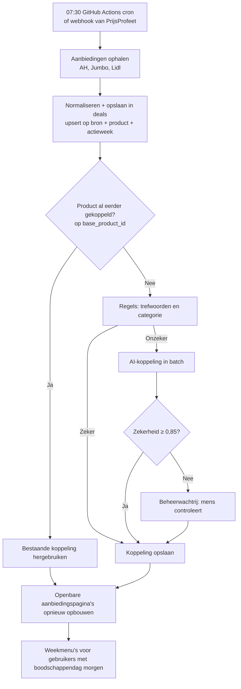

# 06 — Data: aanbiedingen, ingrediënten en recepten

Potje draait op drie soorten data:

| Data | Bron | Hoe vaak | Eigenaar |
|---|---|---|---|
| **Aanbiedingen** | Externe API (PrijsProfeet), met handmatige invoer als reserve | Elke nacht | Extern |
| **Ingrediënten** (vaste lijst, referentieprijzen, verpakkingen, allergenen) | Zelf samengesteld | Per kwartaal bijwerken | Wij |
| **Recepten** | Zelf geschreven (met AI-hulp, door een mens gecontroleerd) | Wekelijks een paar nieuwe | Wij |

## 1. Aanbiedingen: waar halen we ze vandaan?

Geen enkele Nederlandse supermarkt biedt een officiële openbare API voor aanbiedingen. De opties:

| Optie | Voordelen | Nadelen | Oordeel |
|---|---|---|---|
| **A. PrijsProfeet API** | 20 Nederlandse ketens in één vast formaat; gratis plan mag commercieel gebruikt worden (met bronvermelding); elke nacht ververst; documentatie en OpenAPI-specificatie beschikbaar | Afhankelijk van één leverancier; prijzen van betaalde plannen onbekend; gratis plan bevat alleen aanbiedingen, niet het hele assortiment | ✅ **Primaire bron** |
| **B. Handmatig invoeren** via de beheeromgeving | Volledige controle; werkt altijd | Kost elke week 1–2 uur per supermarkt | ✅ **Reserve**, en voor het concierge-experiment in fase 0 |
| **C. Zelf websites of apps van supermarkten uitlezen (scrapen)** | Gratis | Kan in strijd zijn met de gebruiksvoorwaarden van de supermarkten en met het databankenrecht; breekt bij elke wijziging; veel onderhoud | ❌ **Niet doen** |
| **D. Samenwerking met een supermarkt of folderplatform** | Officiële data, mogelijk inkomsten | Pas haalbaar met bereik | Later onderzoeken |

### PrijsProfeet: wat we inmiddels zeker weten (getest november 2026)

- De API werkt zonder sleutel. We gebruiken `GET /api/v1/search?q=*&retailer=…&category=…&promotion_status=active|upcoming` (filter op categorie, max. 100 per pagina, 120 verzoeken/minuut per IP zonder sleutel). Een verzoek duurt ±0,5 s.
- Ketensleutels: `albert_heijn`, `jumbo`, `lidl` (en `aldi`, `plus`, `dirk` …).
- Deze week: AH 3.124 aanbiedingen, Jumbo 2.116, Lidl 286. AH en Jumbo geven vrijwel altijd een normale prijs (`original_price`); **Lidl meestal niet** — daar rekenen we de besparing tegen onze referentieprijs en tonen we "(deels geschat)".
- Velden bevestigd: `original_price`, `multi_buy_quantity` + `multi_buy_price` (totaal voor de bundel), `promotion_type` (`percentage`, `multi_buy`, `one_plus_one`, `volume`, `limited`, `starting`), `unified_category`, `valid_from`/`valid_until`, `loyalty_price` + `loyalty_program`.
- ⚠️ Bij Aldi is `price` de prijs van de hele bundel; daarom doet Aldi nog niet mee.
- **Sleutel:** een onbekende of ingetrokken sleutel geeft géén foutmelding. Het verzoek wordt dan zonder sleutel afgehandeld, met de header `X-PrijsProfeet-Notice: Invalid API key …`. Alleen `GET /api/v1/partner/usage` weigert een foute sleutel (403) en geeft bij een goede sleutel het plan en de limiet. `PrijsProfeetSource` logt zo'n notice (`[deals] PrijsProfeet: …`), en `npm run check:deals` controleert de sleutel via `partner/usage`.
- Een sleutel aanvragen kan alleen via het formulier op prijsprofeet.nl/api (Cloudflare Turnstile): je vult een e-mailadres en projectnaam in en krijgt een mail met een link naar de sleutel. Beheer: prijsprofeet.nl/api-account.
- De websitepagina's van PrijsProfeet (prijzen, voorwaarden) zitten achter een Cloudflare-controle en zijn niet automatisch te lezen. **Lees de voorwaarden zelf in je browser** (prijsprofeet.nl/api) voordat de site live gaat.
- Gebouwd in deze stap: de site haalt de aanbiedingen live op en bewaart ze een paar uur in de cache van Next.js (`lib/deals/live.ts`). De nachtelijke opslag in een database (sectie 2) volgt zodra Supabase is gekoppeld.

### PrijsProfeet: wat de documentatie zegt

Bron: de openbare documentatie op GitHub ([README](https://github.com/PrijsProfeet/supermarkt-api/blob/main/README.en.md), [OpenAPI-specificatie](https://github.com/PrijsProfeet/supermarkt-api)). De Nederlandstalige voorwaarden en prijzen op prijsprofeet.nl konden we niet openen. **Die moeten vóór de bouw gelezen worden.**

**Ketens in Nederland (20):** Albert Heijn, Aldi, Amazing Oriental, Boni, Boon's Markt, Coop, Dagwinkel, DekaMarkt, Dirk, Ekoplaza, Gewoon Coop, Hoogvliet, Jumbo, Lidl, MCD, Nettorama, PLUS, Poiesz, SPAR, Vomar.

**Plannen:**

| Plan | Prijs | Wat zit erin |
|---|---|---|
| Gratis, zonder sleutel | €0 | Zoeken, producten, aanbiedingen, categorieën, wijzigingenfeed, voorspelling. Limieten per IP-adres. |
| Gratis, met sleutel | €0 | Hetzelfde, met hogere limieten (150 verzoeken per minuut). |
| Pro | Op aanvraag, 14 dagen gratis proberen | + koppelen van receptingrediënten aan producten (`/match/ingredients`, bèta), volledige schapprijzen (`/shelf-prices`), prijsgeschiedenis. Geen bronvermelding nodig. |
| Business | Op aanvraag, jaarcontract | + historische schapprijzen, huismerk-alternatieven, hoogste limiet, 99,5% SLA. |

**Voorwaarden (samengevat uit de README):**
- Het gratis plan mag commercieel gebruikt worden, **als je PrijsProfeet zichtbaar vermeldt** op elk scherm met hun data (bijv. "Aanbiedingen via PrijsProfeet" met een link).
- Je mag de data gebruiken en tonen, maar **niet doorverkopen of er de dataset mee nabouwen**.
- De data is indicatief: "controleer een prijs altijd bij de keten zelf".
- Als je plan stopt, moet je de data verwijderen.
- De Nederlandstalige voorwaarden zijn bindend.

**Open vraag (vóór de lancering per mail aan PrijsProfeet voorleggen):**
1. Mogen we de data (met bronvermelding) tonen aan betalende abonnees van onze site?
2. Wat kost Pro, en is `/match/ingredients` geschikt voor ons gebruik?
3. Mogen we afgeleide gegevens bewaren, zoals onze koppeling product → ingrediënt en historische besparingen van gebruikers?

**Belangrijke velden van een aanbieding** (uit de documentatie; niet alle veldnamen zijn bevestigd):
`base_product_id` (stabiele sleutel om op te slaan), `product_id` (bevat de actieweek), `retailer`, `name`, `brand`, `ean`, `price`, `multi_buy_quantity`, `multi_buy_price`, `valid_from`, `valid_until`, `valid_until_estimated`, `promotion_status` (`active`, `upcoming`, `shelf`, `historical`), `image_url`, `product_url`, `quantity`, `unit_price`, `in_store_only`, `online_only`, `loyalty_price`.

**Verversing:** elke nacht; rond 07:05 kan PrijsProfeet een melding (webhook) sturen dat de nieuwe data klaarstaat. Wijzigingen komen binnen ongeveer 10 minuten in de wijzigingenfeed.

**Limieten:** zonder sleutel 30 verzoeken per minuut op bulk-endpoints; met gratis sleutel 150 per minuut; Pro 300; Business 1.000. Gebruik geen "bot" of "crawler" in de User-Agent zonder sleutel.

### Afhankelijkheid beperken

We bouwen een eigen tussenlaag, zodat een andere bron later makkelijk in te pluggen is:

```ts
interface DealSource {
  name: 'prijsprofeet' | 'manual';
  fetchDeals(params: { storeSlugs: string[]; date: string }): Promise<NormalizedDeal[]>;
}

type NormalizedDeal = {
  source: string;
  sourceProductId: string;       // base_product_id bij PrijsProfeet
  storeSlug: 'ah' | 'jumbo' | 'lidl' | string;
  title: string;
  brand: string | null;
  ean: string | null;
  priceCents: number;            // actieprijs per stuk
  regularPriceCents: number | null;
  multiBuyQuantity: number | null;
  multiBuyPriceCents: number | null;
  quantityText: string | null;   // ruwe tekst, bijv. "500 g" of "2 x 250 g"
  validFrom: string;             // ISO-datum
  validUntil: string;
  validUntilEstimated: boolean;
  imageUrl: string | null;
  productUrl: string | null;
  loyaltyOnly: boolean;          // alleen met klantenkaart/app (bijv. Lidl Plus)
  raw: unknown;                  // origineel antwoord, voor debuggen
};
```

## 2. De wekelijkse datapijplijn



Stappen in detail:

1. **Ophalen:** alle aanbiedingen met status `active` of `upcoming` voor de gekozen ketens.
2. **Filteren:** alleen voedingsmiddelen die relevant zijn voor koken. Drogisterij, huishoudartikelen, snoep, frisdrank en alcohol worden overgeslagen (op categorie, met AI als vangnet).
3. **Hoeveelheid ontleden:** "500 g", "2 x 250 g", "per kilo", "per stuk", "bos", "1,5 l" → `{ amount: 500, unit: 'g' }`. Eerst met reguliere expressies; wat niet lukt, gaat mee in de AI-stap.
4. **Koppelen aan een ingrediënt:** zie hieronder.
5. **Controle:** de beheerder werkt de wachtrij af (doel: < 30 minuten per week).
6. **Publiceren:** de openbare pagina's worden opnieuw gegenereerd en de weekmenu's worden gemaakt.

Elke run wordt gelogd in de tabel `job_runs` (start, einde, aantallen, fouten). Mislukt een run, dan krijgt de beheerder een mail. De weekmenu's gebruiken dan de data van de vorige run.

## 3. Aanbiedingen koppelen aan ingrediënten

Dit is de lastigste datastap. Een product als "Jumbo Kipdijfilet Naturel 2 x 300 g" moet worden herkend als ingrediënt `kipdijfilet` met een verpakking van 600 g.

**Volgorde van methoden (goedkoopste eerst):**

1. **Geheugen:** een product (`base_product_id`) dat eerder is gekoppeld en goedgekeurd, krijgt dezelfde koppeling. Na een paar weken wordt het grootste deel van de aanbiedingen zo afgehandeld, omdat veel acties terugkomen.
2. **Regels:** een trefwoordenlijst per ingrediënt ("kipdij", "kippendij" → `kipdijfilet`) met uitsluitwoorden ("kipdij saté" is een kant-en-klaarproduct).
3. **AI (Claude API):** voor de rest, in één batch per nacht.
4. **Alternatief om te testen:** PrijsProfeet `/match/ingredients` (Pro, bèta) doet het omgekeerde (receptingrediënt → producten). Evalueer tijdens de Pro-proefperiode of dit stap 2–3 kan vervangen.

### AI-koppeling: ontwerp

- **Model:** Claude Opus 5.5 (`claude-opus-5-5`, $4 / $20 per miljoen tokens invoer/uitvoer). Een goedkoper model, zoals Claude Haiku 5.5 ($0,10 / $0,50), kan later worden getest als de volumes groeien. Dat is een eigen keuze; vergelijk dan eerst de kwaliteit op een testset.
- **Message Batches API:** verwerkt asynchroon, tegen 50% van de normale prijs. Dat past bij een nachtelijke job.
- **Gestructureerde uitvoer** (`output_config.format` met een JSON-schema), zodat elk antwoord direct in de database kan.
- **Prompt caching:** de vaste ingrediëntenlijst (~300 regels) staat vooraan in de systeemprompt en wordt gecachet.
- **Effort:** `low` voor deze eenvoudige classificatie (bij Opus 5.5 is `medium` de standaard; denken staat altijd aan).
- **Invoer per verzoek:** 50 producten (naam, merk, hoeveelheidstekst, categorie van de keten).
- **Uitvoer per product:**

```json
{
  "source_product_id": "string",
  "is_cooking_ingredient": true,
  "ingredient_slug": "kipdijfilet | null",
  "pack_amount": 600,
  "pack_unit": "g | ml | stuk",
  "confidence": 0.93,
  "note": "2 x 300 g samengeteld"
}
```

- **Kwaliteitsbewaking:** een vaste testset van 200 handmatig gekoppelde producten. Bij elke wijziging van prompt of model moet de nauwkeurigheid op die set ≥ 95% blijven.

### Kostenraming AI

| Post | Schatting |
|---|---|
| Eerste run: ~3.000 producten (3 ketens), 60 verzoeken | ~$4 (met batchkorting) |
| Daarna per week: ~300–800 nieuwe producten | ~$1 per week |
| Eenmalig: 150 receptconcepten laten schrijven | ~$10–$15 |
| **Per maand na de start** | **~$5–$10** |

Dit zijn ruwe schattingen op basis van de modelprijzen; meet het echte verbruik via de `usage`-velden van de API.

## 4. Ingrediënten: de vaste lijst

Een eigen lijst van **250–400 ingrediënten**. Dit is de spil tussen aanbiedingen en recepten.

| Veld | Voorbeeld | Waarvoor |
|---|---|---|
| `slug` | `rundergehakt` | Unieke sleutel |
| `name` | Rundergehakt | Weergave |
| `aisle` | `vlees_vis` | Sorteren van de boodschappenlijst |
| `base_unit` | `g` | Rekenen |
| `ref_pack_amount` / `ref_pack_price_cents` | 500 / 549 | Referentieprijs als er geen aanbieding is |
| `shelf_life_days` | 2 | Volgorde in de week, verspilling |
| `is_pantry` | `false` | Basisvoorraad (zout, olie) niet meerekenen |
| `allergens` | `[]` | Filter (de 14 wettelijke allergenen) |
| `diet_flags` | `{ meat: true, pork: false, fish: false, animal: true, alcohol: false }` | Dieetfilter |
| `keywords` / `exclude_keywords` | `["rundergehakt","rundgehakt"]` / `["saus","balletjes"]` | Regels voor koppelen |

**Referentieprijzen:** de eerste keer handmatig bepalen (eenmalig, een paar uur) op basis van gangbare normale prijzen. Elk kwartaal bijwerken. Zodra PrijsProfeet Pro (schapprijzen) wordt gebruikt, worden ze automatisch.

**Halal:** de meeste vleesaanbiedingen in supermarkten zijn niet halal. In de eerste versie betekent "halal": vegetarische recepten, vis, en vleesrecepten met een apart halal-ingrediënt (bijv. `kipfilet_halal`) waarvoor alleen expliciet halal-gelabelde aanbiedingen tellen. Vermeld eerlijk dat het aanbod hiervoor in het begin kleiner is.

## 5. Recepten

### Uitgangspunten
- **Gewone Nederlandse thuiskeuken met een budgetblik:** stamppot, ovenschotels, pasta, rijst, curry, soep, wraps, nasi en bami, traybakes.
- **Max. 10 ingrediënten** (exclusief basisvoorraad), **max. 45 minuten**; de helft ≤ 30 minuten.
- **Flexibel:** waar mogelijk varianten ("kip of kikkererwten").
- **Start: minimaal 150 recepten,** waarvan ≥ 40 vegetarisch, ≥ 15 veganistisch, ≥ 20 kindvriendelijk gemarkeerd. Daarna elke week 3–5 nieuwe.
- **Elke receptingrediënt verwijst naar de vaste ingrediëntenlijst.** Zonder die koppeling kan het algoritme niet rekenen.

### Hoe maken we ze?
1. Laat de AI concepten schrijven in het vaste formaat (titel, ingrediënten met hoeveelheden uit onze lijst, stappen), op basis van een lijst gerechten die we zelf kiezen.
2. Een mens controleert elk recept: kloppen de hoeveelheden, de tijden, de stappen?
3. **Kook een steekproef zelf** (bijv. 1 op 5) en pas aan.
4. Publiceer pas als alle velden kloppen (afgedwongen in de beheeromgeving).

### Auteursrecht
- Een lijst ingrediënten is een feit en niet beschermd, maar **receptteksten en foto's zijn dat wel.** Neem nooit teksten of foto's over van Allerhande, Jumbo of andere sites.
- **Foto's:** begin met eigen, eenvoudige telefoonfoto's (daglicht, bovenaanzicht) of zonder foto met een nette illustratie per categorie. AI-gegenereerde foto's kunnen, maar kunnen bij eten als nep overkomen; als je ze gebruikt, wees er open over.

### Receptformaat (opslag)

```json
{
  "slug": "bloemkoolcurry-met-rijst",
  "title": "Bloemkoolcurry met rijst",
  "servings": 4,
  "prep_minutes": 10,
  "cook_minutes": 25,
  "diet_tags": ["vegetarian"],
  "kid_friendly": true,
  "cuisine": "aziatisch",
  "main_protein": "peulvruchten",
  "carb_base": "rijst",
  "ingredients": [
    { "ingredient": "bloemkool", "amount": 0.75, "unit": "stuk" },
    { "ingredient": "kikkererwten_blik", "amount": 400, "unit": "g" },
    { "ingredient": "kokosmelk", "amount": 400, "unit": "ml" },
    { "ingredient": "ui", "amount": 1, "unit": "stuk" },
    { "ingredient": "currypasta", "amount": 2, "unit": "el" },
    { "ingredient": "rijst", "amount": 300, "unit": "g" }
  ],
  "steps": [
    "Kook de rijst volgens de verpakking.",
    "Snijd de ui en de bloemkool in kleine roosjes.",
    "Fruit de ui 3 minuten in een scheutje olie, voeg de currypasta toe en bak 1 minuut mee.",
    "Voeg bloemkool, kikkererwten en kokosmelk toe. Laat 15 minuten zachtjes koken tot de bloemkool gaar is.",
    "Breng op smaak met zout en serveer met de rijst."
  ]
}
```

`main_protein` en `carb_base` worden gebruikt voor de variatiestraf in het algoritme.

## 6. Datakwaliteit en vertrouwen

- Bij elke prijs staat "volgens de aanbiedingsdata van deze week; prijzen in de winkel kunnen afwijken".
- Knop "Klopt niet" bij elke aanbieding (zie [04](04-functionele-specificatie.md), randgevallen).
- Aanbiedingen die alleen met een klantenkaart of app gelden (`loyalty_price`, bijv. Lidl Plus), krijgen een duidelijk label.
- Aanbiedingen met een geschatte einddatum (`valid_until_estimated`) krijgen het label "einddatum onbekend".
