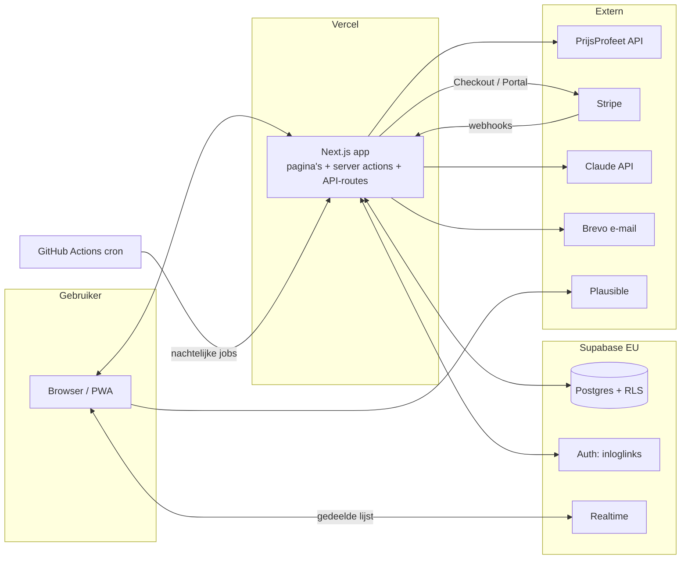

# 07 — Technische architectuur

## Principes

1. **Saaie, bewezen techniek.** Eén codebase, één taal (TypeScript), managed diensten. Geen eigen servers.
2. **Data in de EU.** Database, e-mail en analytics in de EU (AVG).
3. **De kern is pure code.** Het weekmenu-algoritme heeft geen database- of netwerktoegang en is volledig te testen.
4. **Geld in centen.** Alle bedragen als gehele getallen in centen (`price_cents`), nooit als komma-getallen.
5. **Tijd in Europe/Amsterdam.** Datums van weekmenu's en aanbiedingen zijn kalenderdatums in de Nederlandse tijdzone.
6. **Geen betaalgegevens bij ons.** Alles rond betalen gaat via Stripe.

## Stack

| Onderdeel | Keuze | Waarom | Alternatief |
|---|---|---|---|
| Framework | **Next.js** (App Router, TypeScript, laatste stabiele versie) | Website, SEO-pagina's en app in één; server components; groot ecosysteem | Remix, SvelteKit |
| Styling | **Tailwind CSS** + **shadcn/ui** | Snel, consistent, toegankelijke componenten | – |
| Database + auth | **Supabase** (Postgres, Auth, Realtime, regio Frankfurt) | Postgres met Row Level Security, inloglinks per mail, realtime voor de gedeelde lijst | Neon + Auth.js |
| Hosting | **Vercel** (Pro-plan voor commercieel gebruik) | Gemaakt voor Next.js; preview per pull request | Netlify, Cloudflare |
| Betalen | **Stripe** (Checkout, Billing, Customer Portal) | iDEAL \| Wero + SEPA-incasso; kant-en-klaar opzeggen | Mollie |
| E-mail | **Brevo** (of Resend) via SMTP/API | EU-aanbieder; transactiemail en nieuwsbrief | Postmark |
| Geplande taken | **GitHub Actions** (cron) die beveiligde API-routes of scripts aanroepen | Gratis, logs per run, geen tijdslimiet zoals bij serverless functies | Vercel Cron, Supabase pg_cron |
| AI | **Claude API** (Message Batches) | Nachtelijke koppeling aanbiedingen → ingrediënten | – |
| Analytics | **Plausible** (EU, zonder cookies) | Geen cookiebanner nodig voor analytics | Umami (zelf hosten) |
| Foutmeldingen | **Sentry** (EU-regio, gratis plan) | Fouten in productie zien | – |
| Offline / PWA | **Serwist** (service worker voor Next.js) + IndexedDB | Boodschappenlijst werkt zonder internet | – |
| Validatie | **Zod** | Invoer controleren op elke server-actie en API-route | – |
| Tests | **Vitest** (unit), **Playwright** (end-to-end) | – | – |

## Overzicht



## Mappenstructuur

```
/
├── app/
│   ├── (marketing)/              # openbare pagina's: /, /prijzen, /over, /aanbiedingen, /recepten
│   ├── (app)/                    # ingelogd: /week, /lijst, /besparing, /account
│   ├── (beheer)/beheer/          # alleen beheerder
│   ├── lijst/[token]/            # gedeelde lijst
│   └── api/
│       ├── stripe/webhook/route.ts
│       ├── jobs/ingest/route.ts         # aangeroepen door GitHub Actions
│       ├── jobs/match/route.ts
│       ├── jobs/plans/route.ts
│       └── jobs/emails/route.ts
├── components/                   # UI-componenten (shadcn/ui + eigen)
├── lib/
│   ├── planner/                  # ⭐ weekmenu-algoritme — pure functies, geen I/O
│   │   ├── portions.ts
│   │   ├── pricing.ts            # kosten(k), meerstuksacties, verpakkingen
│   │   ├── filters.ts
│   │   ├── score.ts              # kostenfunctie J(M)
│   │   ├── search.ts             # gretig + lokale verbetering
│   │   └── index.ts
│   ├── deals/                    # DealSource-interface, PrijsProfeet-client, normaliseren
│   ├── matching/                 # regels + Claude-batch voor koppelen
│   ├── db/                       # Supabase-clients en queries
│   ├── billing/                  # Stripe-helpers, rechten (entitlements)
│   ├── email/                    # sjablonen en verzenden
│   └── utils/                    # geld, datums (Europe/Amsterdam), formatteren
├── supabase/
│   ├── migrations/               # SQL-migraties (bron van waarheid voor het schema)
│   └── seed/                     # winkels, ingrediënten, startrecepten
├── scripts/                      # eenmalige scripts (import recepten, testset)
├── tests/
│   ├── unit/                     # Vitest, vooral lib/planner
│   └── e2e/                      # Playwright
├── .github/workflows/            # ci.yml, nightly-jobs.yml
└── docs/                         # deze documentatie
```

## Datamodel

Alle tabellen hebben `created_at timestamptz default now()`. Row Level Security (RLS) staat **aan op elke tabel**.

```sql
-- Winkels
create table stores (
  id          text primary key,                 -- 'ah', 'jumbo', 'lidl'
  name        text not null,
  price_factor numeric(4,2) not null default 1.00,  -- v1-schatting voor referentieprijzen
  active      boolean not null default true
);

-- Vaste ingrediëntenlijst
create table ingredients (
  id                   uuid primary key default gen_random_uuid(),
  slug                 text unique not null,
  name                 text not null,
  aisle                text not null,           -- 'groente_fruit','vlees_vis','zuivel','houdbaar','diepvries','brood','overig'
  base_unit            text not null check (base_unit in ('g','ml','stuk')),
  ref_pack_amount      numeric not null,
  ref_pack_price_cents integer not null,
  shelf_life_days      integer not null default 7,
  is_pantry            boolean not null default false,
  allergens            text[] not null default '{}',
  diet_flags           jsonb not null default '{}',   -- {meat, pork, fish, animal, alcohol, halal_certified}
  keywords             text[] not null default '{}',
  exclude_keywords     text[] not null default '{}'
);

-- Aanbiedingen (genormaliseerd)
create table deals (
  id                     uuid primary key default gen_random_uuid(),
  source                 text not null,          -- 'prijsprofeet' | 'manual'
  source_product_id      text not null,          -- stabiel product-ID van de bron
  store_id               text not null references stores(id),
  title                  text not null,
  brand                  text,
  ean                    text,
  price_cents            integer not null,
  regular_price_cents    integer,
  multi_buy_quantity     integer,
  multi_buy_price_cents  integer,
  quantity_text          text,
  pack_amount            numeric,               -- na ontleden
  pack_unit              text,
  valid_from             date not null,
  valid_until            date not null,
  valid_until_estimated  boolean not null default false,
  loyalty_only           boolean not null default false,
  image_url              text,
  product_url            text,
  raw                    jsonb,
  unique (source, source_product_id, store_id, valid_from)
);
create index on deals (store_id, valid_from, valid_until);

-- Koppeling product → ingrediënt (onthouden per stabiel product-ID)
create table product_matches (
  source             text not null,
  source_product_id  text not null,
  ingredient_id      uuid references ingredients(id),   -- null = geen kookingrediënt
  confidence         numeric(3,2) not null,
  method             text not null check (method in ('memory','rule','llm','manual')),
  status             text not null default 'pending' check (status in ('pending','approved','rejected')),
  reviewed_at        timestamptz,
  primary key (source, source_product_id)
);

-- Recepten
create table recipes (
  id            uuid primary key default gen_random_uuid(),
  slug          text unique not null,
  title         text not null,
  description   text,
  servings      integer not null default 4,
  prep_minutes  integer not null,
  cook_minutes  integer not null,
  diet_tags     text[] not null default '{}',     -- afgeleid van ingrediënten, gecontroleerd bij publiceren
  kid_friendly  boolean not null default false,
  cuisine       text,
  main_protein  text,
  carb_base     text,
  steps         jsonb not null,                    -- array van strings
  image_url     text,
  status        text not null default 'draft' check (status in ('draft','published','archived')),
  avg_rating    numeric(3,2)
);

create table recipe_ingredients (
  recipe_id      uuid references recipes(id) on delete cascade,
  ingredient_id  uuid references ingredients(id),
  amount         numeric not null,
  unit           text not null,                    -- 'g','ml','stuk','el','tl' (el/tl omgerekend bij rekenen)
  optional       boolean not null default false,
  note           text,
  primary key (recipe_id, ingredient_id)
);

-- Gebruikersprofiel (1-op-1 met auth.users)
create table profiles (
  id                     uuid primary key references auth.users(id) on delete cascade,
  role                   text not null default 'user' check (role in ('user','admin')),
  adults                 integer not null default 2,
  children               jsonb not null default '[]',    -- [{ "ageGroup": "4-8" }]
  dinners_per_week       integer not null default 5,
  budget_cents           integer,
  store_ids              text[] not null default '{ah}',
  shop_weekday           integer not null default 6,     -- 1 = maandag … 7 = zondag
  diet                   text not null default 'none',
  allergens              text[] not null default '{}',   -- alleen met toestemming (zie 09)
  excluded_ingredient_ids uuid[] not null default '{}',
  max_cook_minutes       integer,
  sensitive_data_consent_at timestamptz,                 -- toestemming dieet/allergieën
  weekly_email           boolean not null default true,
  premium_trial_until    timestamptz,                    -- 14 dagen na aanmelden
  stripe_customer_id     text unique
);

-- Abonnementen (gespiegeld vanuit Stripe-webhooks)
create table subscriptions (
  id                    text primary key,                -- Stripe subscription ID
  user_id               uuid not null references profiles(id) on delete cascade,
  status                text not null,                   -- active, past_due, canceled, …
  price_id              text not null,
  interval              text not null check (interval in ('month','year')),
  current_period_end    timestamptz not null,
  cancel_at_period_end  boolean not null default false,
  updated_at            timestamptz not null default now()
);

-- Weekmenu's
create table week_plans (
  id                 uuid primary key default gen_random_uuid(),
  user_id            uuid not null references profiles(id) on delete cascade,
  shop_date          date not null,
  store_id           text not null references stores(id),
  budget_cents       integer,
  total_cents        integer not null,
  savings_cents      integer not null,
  algorithm_version  text not null,
  input_snapshot     jsonb not null,                     -- voor debuggen en vergelijken
  unique (user_id, shop_date)
);

create table week_plan_meals (
  plan_id     uuid references week_plans(id) on delete cascade,
  day_index   integer not null,                          -- 0 = boodschappendag
  recipe_id   uuid not null references recipes(id),
  portions    numeric(4,2) not null,
  locked      boolean not null default false,
  reason      text,                                      -- "Gehakt is 1+1 gratis bij Lidl"
  primary key (plan_id, day_index)
);

create table shopping_list_items (
  id              uuid primary key default gen_random_uuid(),
  plan_id         uuid not null references week_plans(id) on delete cascade,
  ingredient_id   uuid references ingredients(id),       -- null bij handmatige regel
  deal_id         uuid references deals(id),
  label           text not null,                         -- "Rundergehakt, 2 × 500 g"
  packs           integer,
  price_cents     integer,
  regular_price_cents integer,
  aisle           text not null,
  is_pantry       boolean not null default false,
  checked_at      timestamptz,
  sort_order      integer not null default 0
);

create table share_links (
  token       text primary key,                          -- willekeurig, ≥ 128 bits
  plan_id     uuid not null references week_plans(id) on delete cascade,
  revoked_at  timestamptz
);

create table recipe_ratings (
  user_id    uuid references profiles(id) on delete cascade,
  recipe_id  uuid references recipes(id) on delete cascade,
  rating     text not null check (rating in ('like','dislike')),
  primary key (user_id, recipe_id)
);

-- Overig
create table waitlist (
  email          text primary key,
  confirmed_at   timestamptz,
  referral_code  text unique not null,
  referred_by    text,
  utm_source     text,
  stores         text[],
  household_size integer
);

create table deal_reports (
  id        uuid primary key default gen_random_uuid(),
  deal_id   uuid not null references deals(id),
  user_id   uuid references profiles(id) on delete set null,
  reason    text
);

create table job_runs (
  id          uuid primary key default gen_random_uuid(),
  job         text not null,
  started_at  timestamptz not null default now(),
  finished_at timestamptz,
  ok          boolean,
  stats       jsonb,
  error       text
);
```

### RLS in het kort
- `profiles`, `week_plans`, `week_plan_meals`, `shopping_list_items`, `recipe_ratings`, `subscriptions`: een gebruiker leest en schrijft **alleen eigen rijen** (`user_id = auth.uid()`). `subscriptions` is alleen-lezen voor de gebruiker; alleen de webhook (service role) schrijft.
- `recipes` (gepubliceerd), `recipe_ingredients`, `ingredients`, `stores`, `deals`: iedereen mag lezen, alleen beheerders schrijven.
- `product_matches`, `job_runs`, `deal_reports`, `waitlist`: alleen service role en beheerders.
- Gedeelde lijst: via een server-route die het token controleert en de service role gebruikt. Geen directe databasetoegang voor anonieme gebruikers.

## Rechten (entitlements)

Eén functie bepaalt overal of iemand Premium heeft:

```ts
function isPremium(profile, subscription, now = new Date()): boolean {
  if (profile.premium_trial_until && now < profile.premium_trial_until) return true;
  if (!subscription) return false;
  if (subscription.status === 'active' || subscription.status === 'trialing') return true;
  // Respijt tijdens opnieuw proberen van een mislukte betaling
  if (subscription.status === 'past_due' && now < addDays(subscription.current_period_end, 7)) return true;
  return false;
}
```

De Gratis-grenzen (3 avonden, 1 winkel, 1 wissel) worden **op de server** afgedwongen, niet alleen in de interface.

## Stripe-koppeling

| Moment | Actie |
|---|---|
| "Word Premium" | Server action maakt een Checkout Session (`mode: 'subscription'`, prijzen maand/jaar, `customer` of `customer_email`, iDEAL \| Wero en kaart als betaalmethoden, `locale: 'nl'`). |
| Webhook `checkout.session.completed` | Koppel `stripe_customer_id` aan het profiel. |
| Webhooks `customer.subscription.created/updated/deleted` | Spiegel status, periode-einde en `cancel_at_period_end` in `subscriptions`. |
| Webhook `invoice.payment_failed` | Mail "betaling mislukt" met link naar het Customer Portal. |
| "Abonnement beheren / opzeggen" | Server action maakt een Customer Portal-sessie (opzeggen aan het einde van de periode staat aan). |
| "Overeenkomst herroepen" (binnen 14 dagen) | Server action: abonnement direct beëindigen in Stripe + terugbetaling volgens de voorwaarden + bevestigingsmail. |

Elke webhook: **handtekening controleren** (`STRIPE_WEBHOOK_SECRET`) en **idempotent** verwerken (op event-ID).

## Geplande taken

| Job | Wanneer (NL-tijd) | Wat |
|---|---|---|
| `ingest` | Dagelijks 07:30 (na de nachtelijke verversing van PrijsProfeet) | Aanbiedingen ophalen en opslaan |
| `match` | Direct na `ingest` | Geheugen → regels → Claude-batch indienen |
| `match-collect` | Elk uur tot de batch klaar is | Batchresultaten ophalen en opslaan |
| `public-pages` | Na `match` | Openbare aanbiedingspagina's opnieuw genereren (`revalidatePath`) |
| `plans` | Dagelijks 16:00 | Weekmenu's maken voor gebruikers van wie de boodschappendag morgen is |
| `emails` | Dagelijks 18:00 | Weekmenumails versturen |
| `trial-reminders` | Dagelijks 10:00 | Mails op dag 12 en dag 15 van de proefperiode |

GitHub Actions roept beveiligde API-routes aan met een geheim token (`CRON_SECRET`). Elke job is **idempotent**: twee keer draaien geeft hetzelfde resultaat.

## Offline boodschappenlijst (PWA)

- De app is installeerbaar (manifest, iconen, `display: standalone`).
- De service worker cachet de app-schil en de lijst van deze week.
- Afvinken gaat eerst naar IndexedDB en wordt gesynchroniseerd zodra er verbinding is ("laatste wijziging wint" per regel).
- De gedeelde lijst gebruikt Supabase Realtime, zodat afvinken direct zichtbaar is bij de ander.

## Omgevingsvariabelen

```
NEXT_PUBLIC_SITE_URL=
NEXT_PUBLIC_SUPABASE_URL=
NEXT_PUBLIC_SUPABASE_ANON_KEY=
SUPABASE_SERVICE_ROLE_KEY=          # alleen op de server
STRIPE_SECRET_KEY=
STRIPE_WEBHOOK_SECRET=
STRIPE_PRICE_MONTHLY=
STRIPE_PRICE_YEARLY=
PRIJSPROFEET_API_KEY=
ANTHROPIC_API_KEY=
BREVO_API_KEY=
CRON_SECRET=
SENTRY_DSN=
NEXT_PUBLIC_PLAUSIBLE_DOMAIN=
```

Geheimen staan alleen in Vercel en GitHub Actions secrets, nooit in de repository. Er komt een `.env.example` zonder waarden.

## Beveiliging

- RLS op elke tabel (zie hierboven). De service role key wordt alleen in server-code gebruikt.
- Zod-validatie op elke server action en API-route.
- Rate limiting op wachtlijst, inloglinks en "klopt niet"-meldingen.
- Strikte security headers (CSP, HSTS, `X-Frame-Options`).
- Beheerroutes controleren `role = 'admin'` op de server.
- Tokens voor gedeelde lijsten: willekeurig, minimaal 128 bits, intrekbaar.
- Afhankelijkheden up-to-date houden (Dependabot).

## Kwaliteit

| Niveau | Wat | Waar |
|---|---|---|
| Unit | Algoritme (alle gevallen uit [05](05-weekmenu-algoritme.md) §6), prijsberekening, hoeveelheden ontleden, `isPremium` | Vitest |
| Integratie | Database-queries en RLS-regels tegen een lokale Supabase | Vitest + Supabase CLI |
| End-to-end | Registreren → onboarding → weekmenu → lijst afvinken; upgraden in Stripe-testmodus; opzeggen | Playwright |
| CI | Lint, typecheck, tests en build bij elke pull request | GitHub Actions |

## Omgevingen

| Omgeving | Database | Stripe | Doel |
|---|---|---|---|
| Lokaal | Supabase CLI (Docker) | Testmodus + Stripe CLI voor webhooks | Ontwikkelen |
| Preview | Apart Supabase-project "staging" | Testmodus | Elke pull request |
| Productie | Supabase-project "production" (Frankfurt) | Live | Gebruikers |

## Belangrijke beslissingen (kort)

| Beslissing | Gekozen | Afgewezen | Reden |
|---|---|---|---|
| Web of app | Web + PWA | Native app | Geen 15–30% afdracht aan app stores, één codebase, vindbaar in Google, betalen via iDEAL. |
| AI per gebruiker | Nee, deterministisch algoritme | LLM maakt elk menu | Voorspelbaar, uitlegbaar, testbaar, gratis per berekening. AI alleen in de nachtelijke datastap. |
| Wachtwoorden | Inloglinks per mail | Wachtwoorden | Minder support en beveiligingsrisico. |
| Betalen | Stripe | Mollie | Kant-en-klaar klantportaal en abonnementsbeheer. |
| Aanbiedingsdata | PrijsProfeet + eigen tussenlaag | Zelf scrapen | Juridisch en technisch minder risico. |
