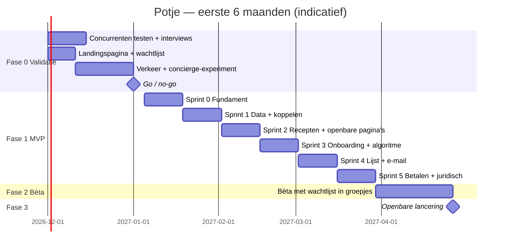

# 11 — Roadmap en validatie

## Status (26 november 2026)

| Onderdeel | Status |
|---|---|
| Specificatie (docs 01–12) | ✅ |
| Landingspagina + wachtlijst (fase 0) | ✅ gebouwd, wacht op Supabase/Brevo-sleutels om live te gaan |
| Ingrediëntenlijst (±70, incl. basisvoorraad) en 34 recepten | ✅ eerste versie — doel 150 recepten |
| Aanbiedingen ophalen (PrijsProfeet), normaliseren, koppelen aan ingrediënten (regels) | ✅ live getest op AH, Jumbo, Lidl |
| Weekmenu-algoritme v1.0.0 + tests | ✅ |
| `/weekmenu`: gratis weekmenu + boodschappenlijst zonder account | ✅ |
| Database, accounts, onboarding, wekelijkse mail | ⏳ volgende stap (sprint 3–4) |
| AI-koppeling (Claude) en beheeromgeving | ⏳ |
| Betalen (Stripe) | ⏳ pas na KvK-inschrijving |

Uitgangspunt: **één persoon, ~10–15 uur per week.** Bij meer tijd gaat alles sneller; de volgorde blijft gelijk.

## Fase 0 — Validatie (4–6 weken, vóór er productcode wordt geschreven)

**Doel:** bewijzen dat mensen dit willen **en ervoor willen betalen**, en dat ons onderscheid echt een onderscheid is.

### Taken
1. **Concurrenten zelf testen** met de checklist uit [02](02-markt-en-concurrentie.md). Leg de resultaten vast in `docs/onderzoek/concurrenten.md`.
2. **10 gesprekken** met mensen uit de doelgroep (script hieronder). Leg ze vast in `docs/onderzoek/interviews.md`.
3. **Naam kiezen** en domein, handelsnaam en merk controleren (zie [09](09-juridisch-en-administratie.md)).
4. **Landingspagina met wachtlijst live** (US-1.1 t/m 1.3). Eenvoudig: Next.js + Supabase-tabel `waitlist` + Plausible. Met een voorbeeldweekmenu als plaatje en het early-adopter-aanbod (€2,99 per maand).
5. **Verkeer genereren:** 3–5 video's, posts in 5–10 communities, en een advertentietest van €100–€200 met 2–3 verschillende koppen.
6. **Concierge-experiment:** maak voor **10–15 huishoudens van de wachtlijst 3 weken lang met de hand** een weekmenu met boodschappenlijst (spreadsheet + aanbiedingen uit de folder) en stuur het per mail. Vraag na week 2 of ze **€2,99 per maand** zouden betalen, en bied ze aan om daadwerkelijk vooruit te betalen voor de eerste 3 maanden.

### Go / no-go-criteria

| Signaal | Doorgaan als |
|---|---|
| Bevestigde aanmeldingen op de wachtlijst | ≥ 300 in 4 weken |
| Conversie van de landingspagina | ≥ 8% van de bezoekers |
| Concierge: wil betalen | ≥ 5 van de 15 huishoudens |
| Concierge: gebruikt het menu echt | ≥ 60% kookt minstens 3 recepten per week |
| Interviews | ≥ 6 van de 10 noemen boodschappenkosten of "wat eten we" als echt probleem, en zijn niet tevreden met wat ze nu gebruiken |
| Concurrentietest | Ons onderscheid (bespaarteller, budget als harde grens, goedkoopste winkel, restjesplanning) wordt nergens al goed gedaan |

**Lukt het niet?** Kies niet meteen een ander idee, maar test eerst één andere positionering met dezelfde landingspagina (bijv. alleen studenten, alleen gezinnen met kinderen, of halal). Lukt dat na één extra ronde ook niet, kies dan een ander idee.

### Interviewscript (15–20 minuten)

Vraag naar wat mensen **gedaan hebben**, niet wat ze **zouden doen**:
1. Hoe ging het boodschappen doen vorige week? Waar, wanneer, met wie?
2. Hoe bepaalde je wat jullie zouden eten?
3. Hoeveel geven jullie ongeveer per week uit aan boodschappen? Hoe weet je dat?
4. Wat doe je nu al om te besparen? (Folders, apps, huismerken, lijstjes?)
5. Wanneer heb je voor het laatst eten weggegooid? Wat was het?
6. Heb je ooit een app of site gebruikt voor weekmenu's of aanbiedingen? Waarom gestopt?
7. Betaal je nu voor een app of abonnement dat met eten of geld te maken heeft?
8. (Aan het eind, laat het voorbeeldmenu zien) Wat valt je op? Wat zou je hiervoor betalen?

## Fase 1 — MVP (6 sprints van 2 weken)

Elke sprint eindigt met iets dat werkt en online staat (preview of productie).

### Sprint 0 — Fundament
- Next.js-project (TypeScript, App Router), Tailwind, shadcn/ui, ESLint/Prettier.
- Supabase-projecten (lokaal, staging, productie), eerste migraties: `stores`, `ingredients`, `waitlist`, `job_runs`.
- Vercel-koppeling, preview per pull request.
- GitHub Actions CI: lint, typecheck, test, build.
- `DESIGN.md` met kleuren, typografie en componenten (zie [08](08-ontwerp-en-merk.md)).
- `.env.example`, README voor ontwikkelaars.
- **Klaar als:** de landingspagina uit fase 0 draait op de nieuwe basis.

### Sprint 1 — Data en koppelen
- `DealSource`-interface + PrijsProfeet-client + normaliseren + `deals`-tabel.
- Ingrediëntenlijst v1 (250+ items) met referentieprijzen en trefwoorden (`supabase/seed`).
- Koppelen: geheugen → regels → Claude-batch; tabel `product_matches`.
- Beheerpagina `/beheer/aanbiedingen` (wachtrij goedkeuren).
- Nachtelijke GitHub Action `ingest` + `match`.
- Testset van 200 gekoppelde producten; nauwkeurigheid meten.
- **Klaar als:** elke ochtend staan de aanbiedingen van AH, Jumbo en Lidl gekoppeld in de database, en de controle kost < 30 minuten.

### Sprint 2 — Recepten en openbare pagina's
- Tabellen `recipes` en `recipe_ingredients`; beheerpagina voor recepten.
- 150 recepten ingevoerd (AI-concepten + controle; zie [06](06-data-en-aanbiedingen.md)).
- `lib/planner/pricing.ts`: prijs per recept per winkel.
- Openbare pagina's `/aanbiedingen/[supermarkt]`, `/recepten`, `/recepten/[slug]` met gestructureerde data.
- **Klaar als:** de openbare aanbiedingspagina's worden elke ochtend automatisch bijgewerkt en zijn geïndexeerd in Google Search Console.

### Sprint 3 — Account, onboarding en het algoritme
- Supabase Auth met inloglinks; tabel `profiles` met RLS.
- Onboarding in 5 stappen (US-3.2), incl. toestemming voor gevoelige gegevens.
- `lib/planner/` volledig, met alle unit tests uit [05](05-weekmenu-algoritme.md) §6.
- `/week`: weekmenu tonen, wisselen, vastzetten, overslaan.
- **Klaar als:** een nieuwe gebruiker binnen 3 minuten na registratie een kloppend weekmenu ziet.

### Sprint 4 — Boodschappenlijst en e-mail
- `/lijst`: samengevoegd, op afdeling, afvinken, zelf toevoegen.
- PWA: installeerbaar, offline afvinken met synchronisatie.
- Bespaarteller "deze week".
- Jobs `plans` en `emails`; sjablonen voor de weekmenumail en de inlogmail.
- **Klaar als:** de lijst offline werkt in de winkel en de weekmenumail op tijd aankomt.

### Sprint 5 — Betalen en juridisch
- Stripe-producten en -prijzen; Checkout; webhooks; Customer Portal; `isPremium`.
- Gratis-grenzen op de server afgedwongen.
- Proefperiode van 14 dagen + herinneringsmails.
- Opzeggen (US-8.2) en herroepen (US-8.3).
- Pagina's `/prijzen`, `/voorwaarden`, `/privacy`, `/cookies`, `/over`; gegevens downloaden en account verwijderen.
- End-to-end-tests voor registreren → menu → upgraden → opzeggen.
- **Klaar als:** een testgebruiker in Stripe-testmodus het hele traject kan doorlopen, en de juridische checklist uit [09](09-juridisch-en-administratie.md) is afgevinkt.

## Fase 2 — Bèta (4 weken)

- Nodig de wachtlijst uit in **groepjes van 100** per week; early adopters krijgen €2,99 per maand.
- Feedbackknop in de app + 5 gesprekken per week.
- Wekelijks: fouten oplossen, de grootste lekkage in de funnel aanpakken.
- **Klaar voor lancering als:** ≥ 60% van de bèta-gebruikers in week 2 nog actief is, er geen ernstige fouten openstaan, en ≥ 20 mensen betalen.

## Fase 3 — Lancering en groei (maand 6–12)

| Maand | Focus |
|---|---|
| 6 | Openbare lancering: persbericht, weekmenu-index, video's, communities |
| 6–7 | Should haves: goedkoopste winkel, restjesplanning, gedeelde lijst, bespaarteller per maand/jaar |
| 7–8 | Aldi en Plus toevoegen; favorieten en voorraad |
| 8–9 | Prijstest €4,99 voor nieuwe gebruikers; jaarabonnement promoten |
| 9–12 | Pilot B2B (budgetcoaches, schuldhulpverlening); doorverwijsprogramma; lunch en ontbijt |

## Wat de volgende bouwsessie als eerste doet

1. Sprint 0 uitvoeren (zie hierboven), te beginnen met de landingspagina en wachtlijst voor fase 0.
2. `DESIGN.md` maken.
3. De open beslissingen uit [12](12-risicos-en-open-vragen.md) laten bevestigen door de maker.
